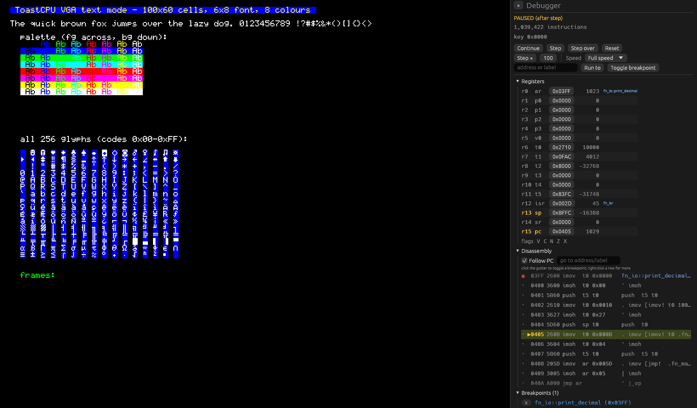

# emu

Emulator for the `toast` CPU. Loads a Quartus `.mif` ROM image and runs it with
the same memory map as the DE1-SoC build (ROM `0x0000-0x7FFF`, VRAM writes to
`0x0000-0x176F`, RAM `0x8000-0xBFFF`, keyboard at `0xFFFF`).

```sh
cargo run --release -p emu -- program.mif                  # render in the terminal
cargo run --release -p emu -- --window program.mif         # render in a native window
cargo run --release -p emu -- --debug program.mif          # window + debugger sidebar open
cargo run --release -p emu -- --paused -b fn_main prog.mif # start paused, break at a label
```

From `sample_programs/src/tl`: `make life EMU_FLAGS=--window`.

| flag | meaning |
|------|---------|
| `-w`, `--window` | Open a window instead of drawing in the terminal |
| `-d`, `--debug` | Window mode with the debugger sidebar expanded (implies `--window`) |
| `--paused` | Start with the CPU paused at `0x0000` (implies `--debug`) |
| `-b`, `--break LIST` | Comma-separated breakpoints: hex addresses or labels, e.g. `fn_main,0x1A` (implies `--debug`) |
| `--scale N` | Window mode: initial integer upscale of the 600x480 screen (default 2) |
| `--fps N` | Window mode: frame-rate cap, `0` = vsync only (default 60) |
| `-j`, `--jit` | Reserved; not implemented yet |

## Front-ends

Both front-ends read the same lock-free VRAM and only redraw cells that changed.

* **Terminal** (default): ANSI escapes via `crossterm`; row 0 is a status bar
  with instructions/s and frames/s. Characters outside printable ASCII appear as
  spaces. Keyboard: `a`-`z` and Enter; `Ctrl-C` quits.
* **Window** (`--window`): an [`egui`/`eframe`](https://github.com/emilk/egui)
  window that rasterises each cell with the FPGA's 6x8 font (generated from
  `fpga/src/drivers/vga_driver.sv` by `tools/gen_font.py`), so you see all 256
  glyphs exactly as the board does. Stats are in the title bar. The window
  stays open after the program halts or hits an error. Keyboard: `a`-`z` and
  Enter, taken from the focused window (ignored while a sidebar text field has
  focus).

Window mode uses OpenGL; on Linux it needs X11 or Wayland (no extra build-time
packages; the libraries are loaded at runtime), and works natively on macOS and
Windows.


## Debugger

The window has a collapsible sidebar on the right (`F1`, the `«`/`»` buttons, or
drag its edge). It shows:

* **Run state**: running / paused (and why) / halted / error, instructions per
  second, total instructions since reset, last key code and pending IRQ.
* **Controls**: Pause/Continue, Step, Step over (runs a `jmpl` call until it
  returns), Step ×N, Reset (CPU, RAM and screen; keeps breakpoints), Run to an
  address or label, and a speed limit from full speed down to 10 instructions/s.
* **Registers**: all 16 with ABI names, hex/signed decimal, the label a value
  points at, and the X/Z/N/C/V flags. Registers that changed since the last
  stop are highlighted. Values are editable while paused.
* **Disassembly**: the whole ROM, following PC, with the assembler's source line
  and labels from the `.mif`. Click the gutter to toggle a breakpoint;
  right-click a row for *Run to here* / *Set PC here*.
* **Breakpoints**: list (click to jump), remove, clear all. Add by address or
  label in the field under the controls.
* **Stack**: words from SP up, annotated with labels for return addresses.
* **Memory**: hex + ASCII view of RAM, ROM or VRAM with go-to.

Hover the screen while the sidebar is open to see the cell's column/row, VRAM
address and value.

| key | action |
|-----|--------|
| `F1` | toggle sidebar |
| `F5` | pause / continue |
| `F10` | step over |
| `F11` | step |
| `F6` | reset |



## Layout

```
src/
  main.rs               CLI
  program.rs            .mif parsing + debug info (source lines, labels)
  io.rs                 SharedIo: VRAM, key/IRQ, shutdown + stats shared across threads
  devices.rs            memory map
  emulator/cpu.rs       Cpu: fetch/decode/execute, interrupts
  emulator/debugger.rs  DebugRunner: pause/step/breakpoints/speed via a command channel
  emulator/disasm.rs    disassembler
  emulator/mod.rs       wires the CPU to a front-end (threads)
  display/terminal.rs   terminal front-end
  display/window.rs     window front-end (screen, input, sidebar toggle)
  display/debug_panel.rs  debugger sidebar
  display/font.rs       generated from the FPGA source
  hardware/             ISA constants, registers, terminal keyboard + scan codes
```

The CPU thread owns all machine state; the UI sends `Command`s over a channel
and reads back a `Snapshot` (registers, RAM, state) that the CPU publishes on
request, so the execution loop never takes a lock while running.
