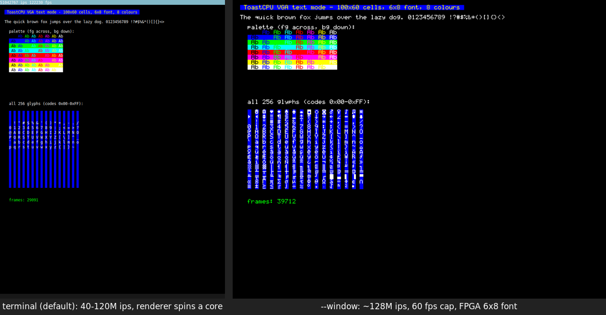

# emu

Emulator for the `toast` CPU. Loads a Quartus `.mif` ROM image and runs it with
the same memory map as the DE1-SoC build (ROM `0x0000-0x7FFF`, VRAM writes to
`0x0000-0x176F`, RAM `0x8000-0xBFFF`, keyboard at `0xFFFF`).

```sh
cargo run --release -p emu -- program.mif            # render in the terminal
cargo run --release -p emu -- --window program.mif   # render in a native window
```

From `sample_programs/src/tl`: `make life EMU_FLAGS=--window`.

| flag | meaning |
|------|---------|
| `-w`, `--window` | Open a window instead of drawing in the terminal |
| `--scale N` | Window mode: integer upscale of the 600x480 screen (1, 2, 4, 8; default 2) |
| `--fps N` | Window mode: frame-rate cap, `0` = uncapped (default 60) |
| `-j`, `--jit` | Reserved; not implemented yet |

## Front-ends

Both front-ends read the same lock-free VRAM and only redraw cells that changed.

* **Terminal** (default): ANSI escapes via `crossterm`; row 0 is a status bar
  with instructions/s and frames/s. Characters outside printable ASCII appear as
  spaces. Keyboard: `a`-`z` and Enter; `Ctrl-C` quits.
* **Window** (`--window`): a [`minifb`](https://crates.io/crates/minifb) window
  that rasterises each cell with the FPGA's 6x8 font (generated from
  `fpga/src/drivers/vga_driver.sv` by `tools/gen_font.py`), so you see all 256
  glyphs exactly as the board does. Stats are in the title bar. The window
  stays open after the program halts or hits an error (shown in the title).
  Keyboard: `a`-`z` and Enter, taken from the focused window.

Window mode needs X11 or Wayland on Linux (no extra build-time packages; the
libraries are loaded at runtime), and works natively on macOS and Windows.



## Layout

```
src/
  main.rs            CLI + .mif parsing
  io.rs              SharedIo: VRAM, key/IRQ, shutdown + stats shared across threads
  devices.rs         memory map
  emulator/cpu.rs    Cpu: fetch/decode/execute, interrupts
  emulator/mod.rs    wires the CPU to a front-end (threads)
  display/terminal.rs, display/window.rs, display/font.rs (generated)
  hardware/          ISA constants, registers, terminal keyboard + scan codes
```
